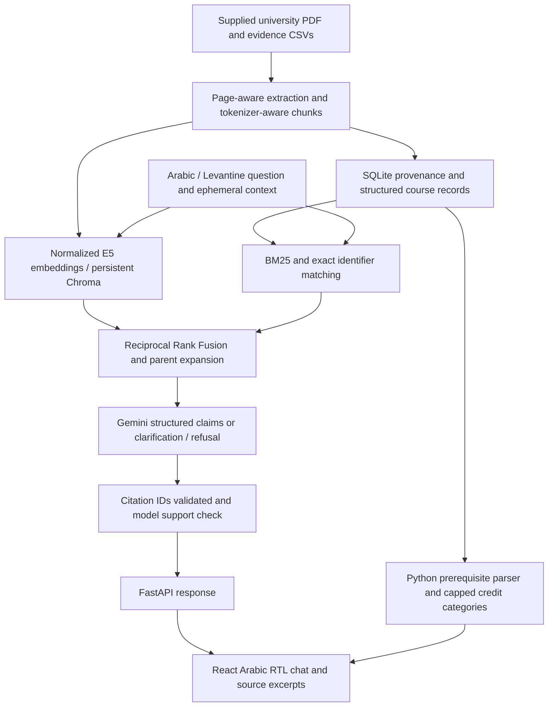

# Architecture

The API never supplies browser code with a Gemini key. Configuration is read on
startup. SQLite and Chroma are local, not remote databases. Course calculations
never call the LLM. The planner assumes only explicitly selected hypothetical
passed courses; proposed courses cannot satisfy each other's prerequisites.

Ingestion whitelists known academic CSVs and PDFs, excludes project instructions
and user-selected prototype rules, and keeps original evidence apart from
normalized search text. CSV provenance is attributed to the supplied extraction,
not asserted independently verified. Academic year applicability is not inferred.

Each active generation points atomically to a completed SQLite database and
Chroma collection. Failed rebuilds retain the old generation. Content and model
configuration determine generation identity; embeddings are cached by content.
Old generations are retained for recovery; manual cleanup is optional. Restart
before using a CLI-built replacement. The token-protected admin endpoint can
rebuild existing local inputs and clear runtime caches. There is no public upload.

Long queries are embedded in complete windows. Chunks never silently exceed the
E5 input limit. Parent evidence expands only within the same section and source
page. Source IDs map to backend records; page numbers are never invented for CSVs.
The claim support check is another Gemini call, not an independent proof of truth.

Sessions contain at most four prior user questions, expire after an hour, and
are limited to 128 in-memory sessions. They reset on restart. No real student
transcripts or personal identities belong in this hackathon prototype.

Optional reranking was not enabled: the local hybrid baseline is evaluated first.
No agents or orchestration frameworks are needed for this bounded pipeline.
